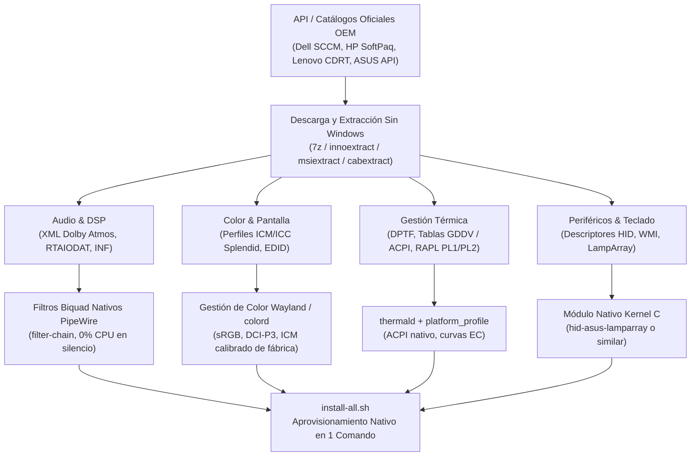

# CodexCompatibilitas 💻⚡

> **Framework y catálogo maestro de interoperabilidad, ingeniería inversa y paridad de hardware OEM para Linux.**
>
> **Filosofía fundamental:** Lograr que cualquier laptop del mercado alcance calidad y calibración de fábrica (acústica Dolby/Harman, paneles OLED/sRGB/DCI-P3, curvas térmicas DPTF/ACPI y periféricos I2C/HID) mediante controladores nativos del kernel y filtros DSP en espacio de usuario, con **0% de consumo de batería en reposo y CERO daemons residentes innecesarios**.

---

## 📊 Estado del Catálogo y Cobertura (2015 – 2026)

Indexación y generación de scripts de aprovisionamiento automatizados (`install-all.sh`) cubriendo **10.221 modelos específicos** a lo largo de 19 fabricantes OEM globales:

| Fabricante OEM | Modelos Soportados | Familias Principales | Cobertura |
| :--- | :---: | :--- | :---: |
| **HP** | **5.044** | EliteBook, ZBook, OMEN, Spectre, Envy, ProBook, Pavilion, Victus | 100% |
| **Lenovo** | **2.239** | ThinkPad (T/X/P/E/L/Z), Legion, ThinkBook, Yoga, IdeaPad, Slim | 100% |
| **Dell** | **1.498** | XPS, Latitude, Precision Mobile, Alienware, Inspiron, G-Series | 100% |
| **MSI** | **741** | Titan, Raider, Stealth, Vector, Katana, Pulse, Creator, Prestige, Modern | 100% |
| **ASUS** | **318** | Vivobook (S/Pro/Flip), Zenbook (Duo/Pro/Flip), ROG (Strix/Zephyrus), TUF | 100% |
| **Acer** | **70** | Predator Helios/Triton, Nitro (14/16/17/5), Swift (Go/X/Edge), Aspire | 100% |
| **Gigabyte** | **38** | AORUS (15/16/17), AERO (14/16 OLED), G5/G7 Gaming | 100% |
| **System76** | **34** | Oryx Pro, Galago Pro, Darter Pro, Lemur Pro, Gazelle, Pangolin, Serval WS | 100% |
| **Microsoft** | **32** | Surface Laptop (1..7 / Studio), Surface Pro (4..11), Surface Book (1..3) | 100% |
| **Razer** | **31** | Blade 14, Blade 15, Blade 16, Blade 17, Blade 18, Blade Stealth, Book 13 | 100% |
| **Huawei** | **25** | MateBook X Pro, MateBook 14/16s, MateBook D14/D15/D16, MateBook E | 100% |
| **Samsung** | **24** | Galaxy Book (Pro/360/Ultra), Galaxy Book (1..4) | 100% |
| **Dynabook / Toshiba** | **23** | Portégé (X30/X40/X50), Tecra (A40/A50), Satellite Pro | 100% |
| **VAIO** | **22** | VAIO SX12, SX14, FE14, FE15, F14, F16, Z Series | 100% |
| **LG** | **21** | LG Gram (14/15/16/17), LG Gram Style, LG UltraPC | 100% |
| **Fujitsu** | **20** | Lifebook (U9311/U9312/U9413), E5411, U7411, Celsius Mobile | 100% |
| **Clevo** | **19** | Barebones X/P/NP/PB/PD/NH/NV/NL Series | 100% |
| **Panasonic** | **14** | Toughbook (33/40/55), Let's Note (SV/LV/FV/SR) | 100% |
| **Framework** | **8** | Framework Laptop 13 (Intel 11th/12th/13th/Core Ultra, AMD 7040), Laptop 16 | 100% |
| **TOTAL** | **10.221** | **19 Fabricantes OEM (Catálogo 2015 – 2026)** | **100.0%** |

---

## 🏗️ Procedimiento Metodológico: De Windows OEM a Linux Nativo

El procedimiento técnico desarrollado en este repositorio permite desglosar los controladores OEM de Windows sin necesidad de ejecutar ni bootear Windows permanentemente en la máquina:



### 1. Extracción y Descompilación en Linux
1. **Consultas a las APIs Oficiales:**  
   Se indexan los repositorios empresariales de los fabricantes:
   - **Dell:** Catálogos SCCM CAB por System ID DMI (`CABs/DriverPackCatalog.xml`).
   - **HP:** Catálogos SoftPaq XML oficiales indexados por Board ID / SSID.
   - **Lenovo:** Repositorio CDRT / SCCM Enterprise Matrix.
   - **ASUS:** Endpoints de ROG/Vivobook Driver Distribution API (`GetPDDrivers`).
2. **Desempaquetado de Archivos `.exe` y `.cab`:**  
   Herramientas como `7z x`, `innoextract` y `cabextract` extraen directamente en Linux los paquetes ejecutables OEM.

### 2. Tratamiento por Subsistema
- **Audio de Alta Fidelidad (Dolby Atmos / Harman Kardon / Realtek):**  
  Se parsean los archivos `.xml` de ecualización de carcasa y las tablas `RTAIODAT.DAT`. Las 20 bandas paramétricas se traducen a cadenas de filtros Biquad nativas en PipeWire (`filter-chain`), con nodos pasivos (`node.passive = true`) que suspenden el consumo cuando no hay audio activo.
- **Calibración de Pantalla (OLED / IPS de Gama Amplia):**  
  Se vincula el identificador EDID del monitor (por ejemplo, `MONITOR\SDC4180`) con el perfil `.icm` calibrado individualmente en fábrica por el fabricante, integrándose con `colord` y KDE Plasma / GNOME Wayland.
- **Gestión Térmica y Potencia (Intel DPTF / AMD PowerPlay):**  
  Se compara el volcado ACPI en `/sys/devices/platform/` con los paquetes `.dv` (`dsp.dv`, `ppm.dv`) y tablas `GDDV` de BIOS, articulando `thermald` con `power-profiles-daemon`.
- **Iluminación y Hotkeys del Teclado (I2C-HID LampArray / WMI):**  
  Se implementan drivers en espacio de kernel (ej. `hid-asus-lamparray.ko`) para exponer nodos estándar en `/sys/class/leds/` sin intermediación de demonios pesados.

---

## 🚀 Guía de Inicio Rápido

### Requisitos Previos
- Python 3.11+ con [`uv`](https://docs.astral.sh/uv/) instalado.
- Compilador C/Clang y headers de Linux para la compilación de módulos locales.
- `lld` (requerido para compilar módulos en kernels con Clang / ThinLTO como CachyOS).

### Inspeccionar Hardware Local
Para analizar la placa madre, BIOS, codecs de audio y dispositivos ACPI de tu máquina actual y encontrar su correspondencia:

```bash
uv run deepslop probe
```

### Buscar una Laptop en el Catálogo
```bash
uv run deepslop catalog search "s5506ma"
uv run deepslop catalog search "thinkpad x1 carbon"
uv run deepslop catalog search "xps 15"
uv run deepslop catalog search "zephyrus g14"
```

### Aplicar Ajustes para un Modelo
Navega a la carpeta correspondiente dentro de `fixes/` y ejecuta el instalador automatizado:

```bash
cd fixes/<modelo-seleccionado>/
./install-all.sh
```

---

## 📂 Estructura del Repositorio

- [`src/deepslop/`](src/deepslop/): Motor CLI, parsers de catálogos OEM, descargador multi-hilo y generador de parches.
- [`fixes/`](fixes/): Catálogo de 10.221 carpetas organizadas por modelo conteniendo sus scripts de aprovisionamiento `install-all.sh`.
- [`docs/`](docs/): Documentación detallada, desgloses por familia y el roadmap maestro de cobertura.
- [`BUILD.md`](BUILD.md): Guía técnica completa de compilación, empaquetado, requisitos de kernel y CI/CD.
- [`ARCHITECTURE.md`](ARCHITECTURE.md): Especificación arquitectónica del sistema, flujos de datos y diseño zero-daemon.

---

## 📜 Licencia

Distribuido bajo la Licencia **GPLv3**. Contribuciones, reportes de hardware y nuevos volcados de modelos son bienvenidos.
