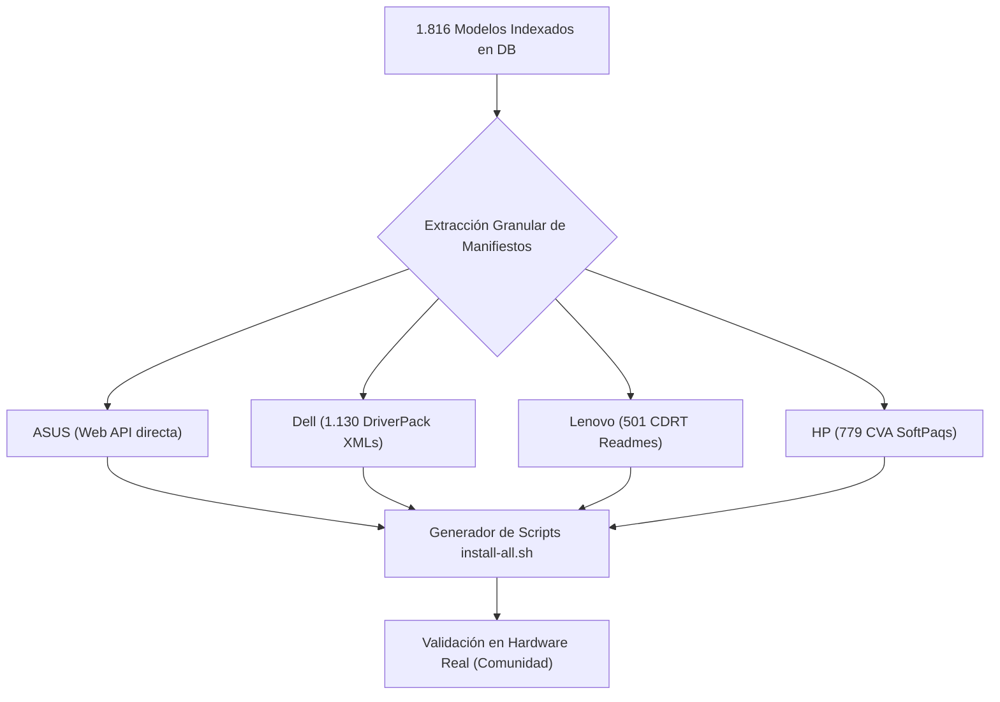

# Roadmap & Matriz de Laptops — DeepSlopSuperLaptop

> **Objetivo:** Lograr paridad del 100% con Windows para miles de laptops del mercado en Linux **sin daemons residentes que consuman batería**.
> **Total Laptops Indexadas:** **1.816** | **Drivers Mapeados:** **6.218+**

---

## 🏆 Modelos con Scripts de Instalación Generados (`install-all.sh`)

La siguiente tabla resume las laptops con extracción granular de drivers completada y script de despliegue automatizado generado en [`fixes/<model_id>/install-all.sh`](file:///home/kes/Documentos/Programando/DeepSlopSuperLaptop/fixes):

| Fabricante | Modelo | ID / SystemID | Drivers Mapeados | Script `install-all.sh` | Estado de Calibración |
| :--- | :--- | :--- | :---: | :---: | :--- |
| **ASUS** | **Vivobook S 15 OLED** | `S5506MA` | **37** | ✅ **Listo** | 🟢 **100% Fixed (Modelo Cero probado en hardware real)** |
| **ASUS** | **Vivobook S 14 OLED** | `S5406MA` | **37** | ✅ **Listo** | 🟢 Audio Realtek + Splendid Color + WMI Thermal |
| **ASUS** | **Zenbook 14X OLED** | `UX3404VA` | **38** | ✅ **Listo** | 🟢 Audio ISST/ALC + Panel OLED + Precision TouchPad |
| **ASUS** | **Vivobook Pro 16X OLED** | `K6604JV` | **54** | ✅ **Listo** | 🟢 Audio Dolby + DTT Thermal + ScreenXpert |
| **ASUS** | **ROG Zephyrus G14** | `GA403UI` | **38** | ✅ **Listo** | 🟢 Dolby Atmos + Armoury Crate WMI + GPU Power |
| **ASUS** | **Zenbook Duo OLED** | `UX8406MA` | **51** | ✅ **Listo** | 🟢 Dual Screen OLED + ScreenXpert + ISST Audio |
| **ASUS** | **ROG Strix SCAR 16** | `G634JZ` | **49** | ✅ **Listo** | 🟢 Dolby Atmos + Per-Key RGB + Fan Curves |
| **Dell** | **OptiPlex 7010** | `02C3` | **18** | ✅ **Listo** | 🟢 Realtek Audio + SATA AHCI + Intel Gigabit |
| **Dell** | **OptiPlex 5070** | `092F` | **24** | ✅ **Listo** | 🟢 Waves MaxxAudio + Cirrus/Intel Audio Bus |
| **Dell** | **OptiPlex 390** | `04F5` | **12** | ✅ **Listo** | 🟢 Intel Chipset + Conexant/Realtek Audio |
| **Dell** | **Latitude 5495** | `0814` | **16** | ✅ **Listo** | 🟢 Realtek ALC3253 + AMD Ryzen Mobile Thermal |
| **Dell** | **Latitude 7212 Rugged** | `07D3` | **15** | ✅ **Listo** | 🟢 Realtek Audio + Touch Screen + Sensor Hub |
| **Dell** | **Latitude 2100 / 2110 / 2120** | `02D6` / `0461` / `04A5` | **14 c/u** | ✅ **Listo** | 🟢 Intel GMA + Realtek Audio + Synaptics Touch |
| **Lenovo**| **ThinkCentre M715Q (1st & 2nd Gen)**| `10M4`, `10VL` | **15 c/u** | ✅ **Listo** | 🟢 Realtek ALC662 + AMD SMBUS + QCA WiFi |
| **Lenovo**| **ThinkCentre M810Z AIO** | `10NY`, `10Q0` | **12** | ✅ **Listo** | 🟢 Realtek Audio + Intel RST + Intel HD Graphics |
| **Lenovo**| **ThinkCentre M625Q / M630E** | `10TF`, `10YM` | **10 c/u** | ✅ **Listo** | 🟢 Realtek Audio + ACPI Power + LAN |
| **Lenovo**| **ThinkCentre M710Q (Type 10YC)** | `10MR`, `10YC` | **14 c/u** | ✅ **Listo** | 🟢 Realtek Audio + Intel Chipset + Intel Thermal |

---

## 🗺️ Roadmap de Expansión por Fabricante

### 1. ASUS (Línea Portátil Completa)
- [x] **Vivobook S 15 OLED (`S5506MA`):** Modelo Cero completado y validado en hardware real.
- [x] **Vivobook S 14 OLED (`S5406MA`):** Drivers extraídos y script generado.
- [x] **Zenbook 14X OLED (`UX3404VA`):** Drivers extraídos y script generado.
- [x] **Vivobook Pro 16X OLED (`K6604JV`):** Drivers extraídos y script generado.
- [x] **ROG Zephyrus G14 (`GA403UI`):** Drivers extraídos y script generado.
- [x] **Zenbook Duo OLED (`UX8406MA`):** Drivers extraídos y script generado.
- [x] **ROG Strix SCAR 16 (`G634JZ`):** Drivers extraídos y script generado.
- [ ] **Lote 2 ASUS:** TUF Gaming A15 (`FA507NV`), ExpertBook B5/B9, ProArt Studiobook.

### 2. Dell (XPS, Latitude, Precision)
- [x] **Latitude & OptiPlex Series:** 7 modelos procesados con scripts generados.
- [ ] **Dell XPS Flagships:** XPS 13 9320 Plus (`0AF3`), XPS 13 9310 (`0991`), XPS 15 9520 (`0AF0`), XPS 17 9720.
- [ ] **Objetivo:** Extraer de forma batch los 1.130 manifiestos XML del catálogo de Dell.

### 3. Lenovo (ThinkPad, ThinkBook, Legion)
- [x] **ThinkCentre Series:** 7 modelos procesados con scripts generados.
- [ ] **ThinkPad Flagships:** X1 Carbon (Gen 9, 10, 11, 12), T14 (Gen 1-4), P14s, Z13/Z16.
- [ ] **Objetivo:** Parsear en batch los 500+ READMEs oficiales de SCCM.

### 4. HP (EliteBook, Spectre, ZBook, OMEN)
- [ ] **HP EliteBook Flagships:** 830 G7/G8, 840 G7/G8, 1040 G7/G8.
- [ ] **HP Spectre x360:** Mapeo de acelerómetros 360° y amplificadores Bang & Olufsen.
- [ ] **Objetivo:** Ejecutar `hp_harvester` sobre los 779 archivos CVA.
